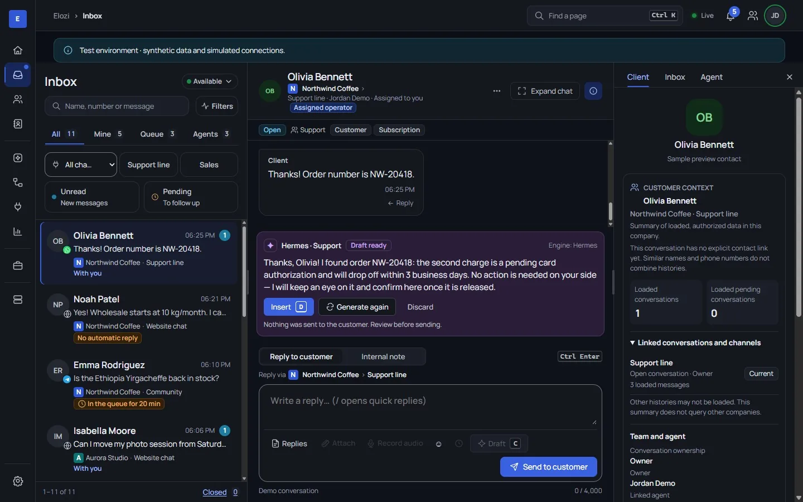
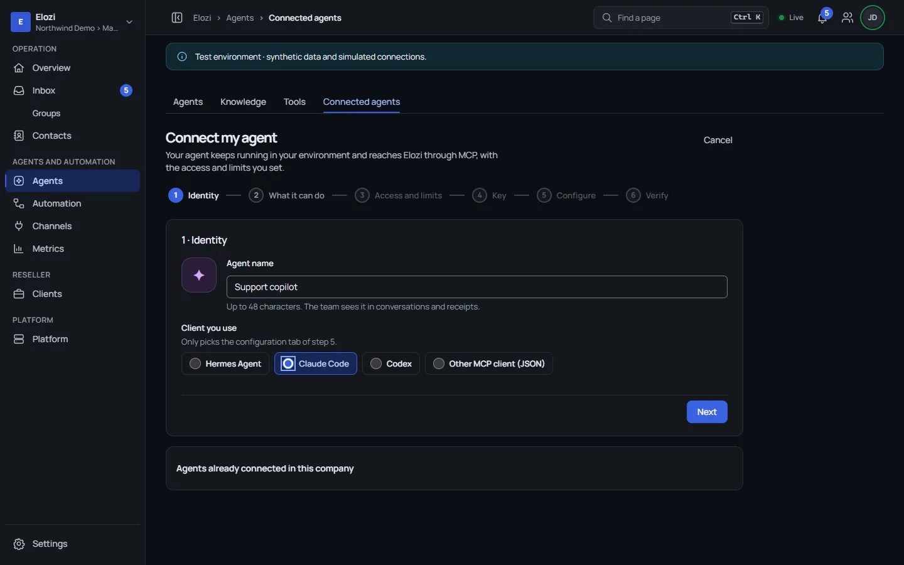
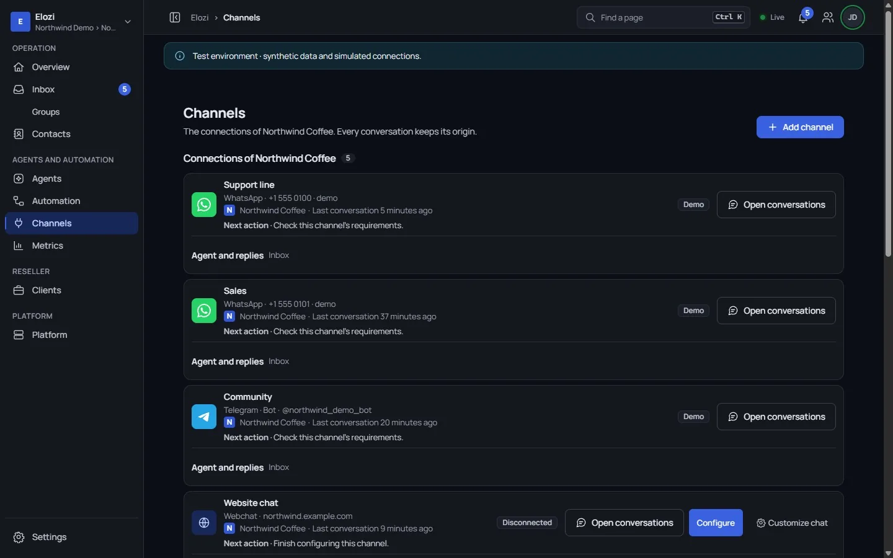
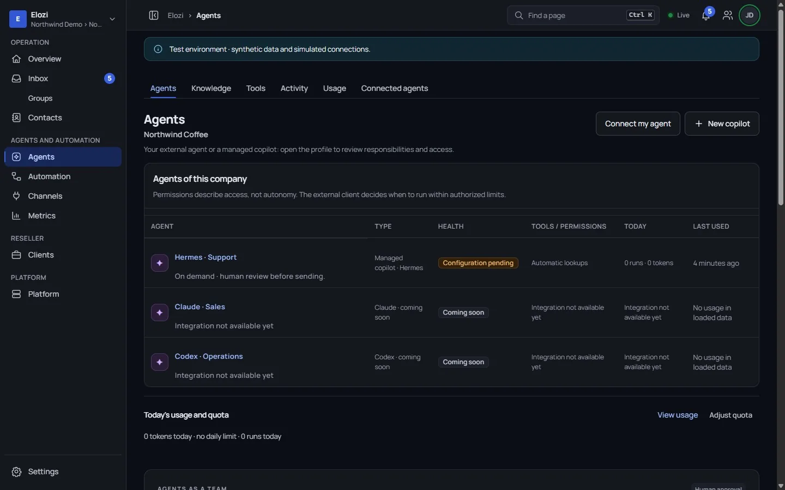
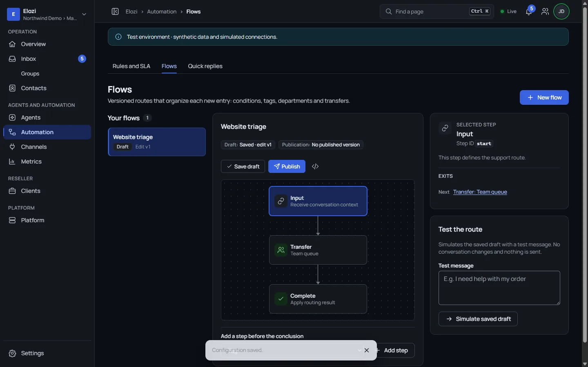
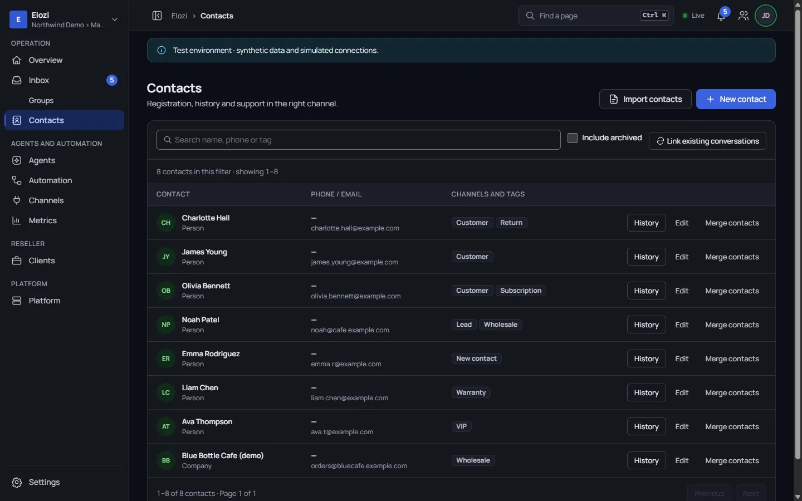
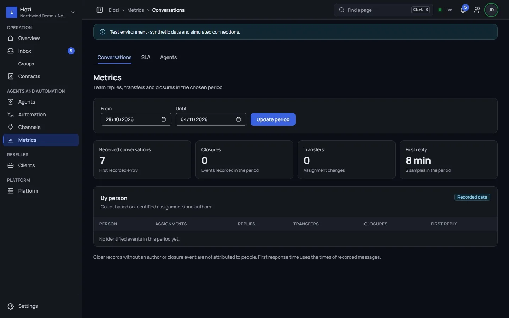
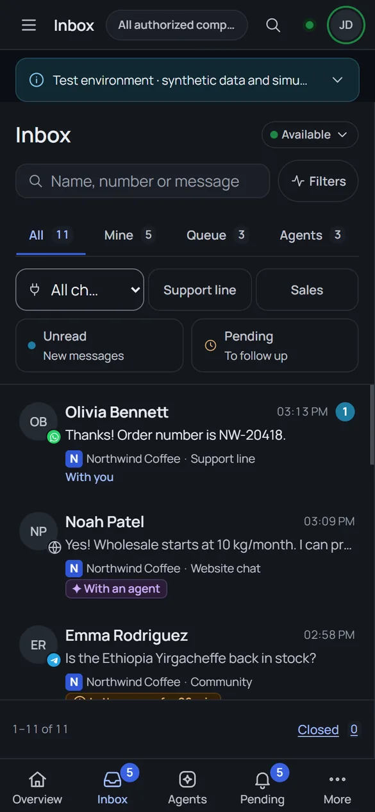
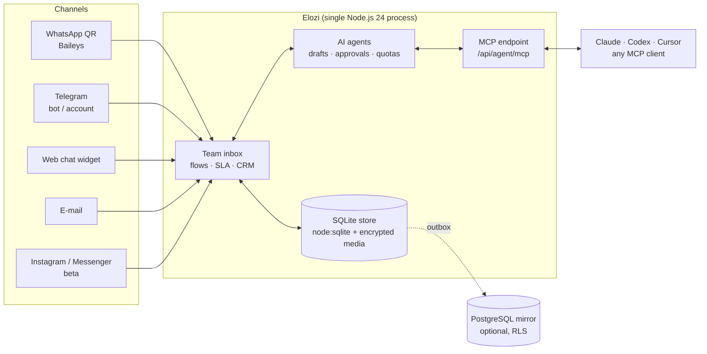

<div align="center">


# Elozi

**The open-source customer-service inbox for small teams — WhatsApp, Telegram, web chat and e-mail in one place,
with AI agents that draft, propose and act only inside the limits you approve.**

[](LICENSE)
[](https://github.com/JE4NVRG/elozi/actions/workflows/ci.yml)
[](https://www.npmjs.com/package/elozi-mcp)
[](package.json)
[](CONTRIBUTING.md)
[](https://github.com/JE4NVRG/elozi/discussions)
[](https://elozi.je4ndev.com)

[Website](https://elozi.je4ndev.com) · [npm (elozi-mcp)](https://www.npmjs.com/package/elozi-mcp) ·
[Quickstart](#quickstart) · [Discussions](https://github.com/JE4NVRG/elozi/discussions)



<sub>Screenshots are from a local instance with synthetic demo data.</sub>

</div>

> **Status:** early open-source release. APIs and the database schema may still change between versions.

## Table of contents

- [Why Elozi](#why-elozi)
- [Connect your AI agent (MCP)](#connect-your-ai-agent-mcp)
- [Features](#features)
- [Quickstart](#quickstart)
- [Configuration](#configuration)
- [Architecture](#architecture)
- [Integrations](#integrations)
- [Roadmap and next integrations](#roadmap-and-next-integrations)
- [WhatsApp disclaimer](#whatsapp-disclaimer)
- [Contributing](#contributing)
- [Community and support](#community-and-support)
- [License](#license)
- [Português (PT-BR)](#português-pt-br)

## Why Elozi

- **One inbox for every channel.** Your team answers WhatsApp, Telegram, the website chat and e-mail from the same
  queue, with owners, departments, tags, notes and SLA targets.
- **AI that asks before it acts.** Agents draft replies and propose tool calls; a person approves, edits or discards.
  Each agent gets scoped capabilities, daily quotas and an audit trail.
- **Bring your own agent.** Claude, Codex, Cursor or any MCP client can work the inbox through a scoped, revocable
  token — no custom integration code.
- **Self-host in minutes.** A single Node.js 24 process with built-in `node:sqlite`. No external database, queue or
  cache required. Several companies per installation.
- **MIT licensed.** Use it, fork it, run it for your clients. A [hosted version](https://elozi.je4ndev.com) is
  available if you prefer not to run it yourself.

## Connect your AI agent (MCP)

Elozi exposes a Streamable HTTP MCP endpoint at `/api/agent/mcp`, plus the stdio bridge
[`elozi-mcp`](https://www.npmjs.com/package/elozi-mcp) (source: [`packages/elozi-mcp`](packages/elozi-mcp)) for
clients that only run local commands.

1. In the panel, open **Agents** and create an agent of type **Agent via MCP** (copilot mode).
2. In **Agents › Connected agents**, create its service identity: channels, departments, capabilities, validity and
   daily quotas. Start with `conversation.read` + `reply.submit` (drafts reviewed by a person).
3. Copy the token (`elozi_svc_…`, shown once) into your MCP client's **private** configuration.

Claude Desktop (`claude_desktop_config.json`) or Cursor (`~/.cursor/mcp.json`):

```json
{
  "mcpServers": {
    "elozi": {
      "command": "npx",
      "args": ["-y", "elozi-mcp@0.1.0"],
      "env": {
        "ELOZI_API_TOKEN": "elozi_svc_YOUR_TOKEN",
        "ELOZI_BASE_URL": "https://elozi.example.com"
      }
    }
  }
}
```

Codex (`~/.codex/config.toml`):

```toml
[mcp_servers.elozi]
command = "npx"
args = ["-y", "elozi-mcp@0.1.0"]
env = { ELOZI_API_TOKEN = "elozi_svc_YOUR_TOKEN", ELOZI_BASE_URL = "https://elozi.example.com" }
```

`ELOZI_BASE_URL` points the bridge at your own Elozi origin (HTTPS; plain HTTP only for `localhost`). Omit it to use
the hosted service at `elozi.je4ndev.com`. Clients with native remote-MCP support (for example Claude Code with
`--transport http`) can connect to `https://<your-host>/api/agent/mcp` directly with a Bearer token. Full guide,
tool list and troubleshooting: [`packages/elozi-mcp/README.md`](packages/elozi-mcp/README.md).



## Features

| | |
|---|---|
| **Unified inbox** – conversations from every channel with filters, search, internal notes, assignments, departments, tags, open/pending/closed states and per-company SLA targets. |  |
| **Channels** – WhatsApp via QR code (unofficial library, see [disclaimer](#whatsapp-disclaimer)), Telegram bot and Telegram account, embeddable web chat widget and e-mail. Encrypted media (images, audio, video, documents). |  |
| **AI agents with guardrails** – Hermes/LLM copilot drafts, tool proposals that need human approval, private knowledge base per company, scoped service tokens with daily quotas, audit trail. |  |
| **Flows and automation** – triggers by channel/entry/command/schedule, versioned publishing and a simulator to test a route before it touches real conversations. |  |
| **Contacts / CRM basics** – people and companies, tags, notes, import, merge and linked conversation history. |  |
| **Metrics** – received conversations, closures, transfers and first-reply time per period, plus SLA and agent usage. |  |
| **Works on your phone** – the panel is responsive, with a bottom navigation for inbox, agents and pending items. |  |

Also included: several companies (and resellers) per installation, roles and invitations, team chat, local password
login (scrypt), optional Google sign-in, encrypted local backups (AES-GCM) with verified restore, idempotent outbox,
health endpoints (`/api/health`, `/api/health/ready`), optional Stripe subscriptions and an English / Portuguese
(PT-BR) UI.

## Quickstart

### Node.js

Requires **Node.js 24+**.

```bash
git clone https://github.com/JE4NVRG/elozi.git
cd elozi
npm ci
npm start
# open http://127.0.0.1:4318 and create the first administrator
```

On a fresh database the panel asks you to create the first administrator. Switch the interface language between
English and Portuguese in **My account** (avatar menu).

Data lives in `data/sandbox.sqlite`; local encryption keys are created under `$LOCALAPPDATA/MEPChat`
(or `~/.local/share/MEPChat` on Linux/macOS). Back them up together; without the keys, encrypted sessions and
media cannot be read.

> `MEPCHAT_PUBLIC_ORIGIN` must be an **HTTPS** origin when set. For a local trial on `http://127.0.0.1`, leave it
> unset — Elozi refuses to start with an `http://` public origin.

### Docker

```bash
docker build -t elozi .
docker run -d --name elozi \
  -p 127.0.0.1:4318:4318 \
  -v elozi-data:/app/data \
  -v elozi-secrets:/run/elozi-secrets-parent \
  elozi
```

Publish the port on loopback and put a TLS reverse proxy (nginx, Caddy) in front of it for public access; then add
`-e MEPCHAT_PUBLIC_ORIGIN=https://chat.example.com` and `-e MEPCHAT_TRUSTED_PROXIES=gateway`.

## Configuration

All settings are environment variables (see [`.env.example`](.env.example); `node --env-file=.env src/server.js`
loads a file — Elozi does not read `.env` by itself).

| Variable | Default | Purpose |
|---|---|---|
| `MEPCHAT_PORT` | `4318` | HTTP port. |
| `MEPCHAT_BIND_ADDRESS` | `127.0.0.1` (`0.0.0.0` in Docker) | Listen address. |
| `MEPCHAT_PUBLIC_ORIGIN` | – | Public **HTTPS** URL used in links, cookies and OAuth callbacks. Leave unset for local HTTP. |
| `MEPCHAT_TRUSTED_PROXIES` | – | Reverse proxies allowed to forward the client IP (`gateway` = Docker network gateway). |
| `MEPCHAT_DOMAIN_CANONICAL_HOST` | hosted Elozi host | Canonical host for custom-domain checks; set it to your own host. |
| `MEPCHAT_PUBLIC_TRIAL_ENABLED` | – | Enables the public self-service sign-up/trial. |
| `MEPCHAT_CONVERSATION_JOURNAL` | `false` | `true` enables the durable conversation journal. |
| `MEPCHAT_GOOGLE_CLIENT_ID` | – | Google Identity Services client id for "Sign in with Google". |
| `MEPCHAT_EMAIL_KEY`, `MEPCHAT_EMAIL_FROM` | – | API key and sender for transactional e-mail (confirmation, invites). |
| `MEPCHAT_AGENT_PROFILE_ORIGINS`, `MEPCHAT_AGENT_ORIGINS` | – | Allowed origins of your AI agent gateway(s). |
| `MEPCHAT_MCP_ORIGINS`, `MEPCHAT_MCP_PRIVATE_ORIGINS` | – | Allowed external MCP server origins. |
| `MEPCHAT_PROTECTED_WORKSPACE_IDS` | – | Comma-separated workspace ids that cannot be deleted. |
| `ELOZI_STRIPE_SECRET_KEY`, `ELOZI_STRIPE_WEBHOOK_SECRET` | – | Optional Stripe billing. |
| `MEPCHAT_DATABASE_TRANSPORT` | SSH (`direct` in Docker) | Transport of the optional PostgreSQL mirror. |
| `MEPCHAT_POSTGRES_SSH_HOST` | – (mirror over SSH disabled) | SSH host alias for the PostgreSQL mirror and `npm run backup -- --postgres`. |
| `MEPCHAT_POSTGRES_CONTAINER` | `supabase-db` | Database container name on that SSH host. |

The PostgreSQL mirror (`db/*.sql`, row-level security per company) is optional; without it Elozi runs fully on
SQLite and logs that PostgreSQL is unavailable.

## Architecture



Everything runs in one process: channel connectors, the HTTP panel, the realtime stream, the agent runtime and the
MCP endpoint. SQLite is the source of truth; the PostgreSQL mirror is optional and fed through an idempotent outbox.

## Integrations

| Integration | Status | Notes |
|---|---|---|
| WhatsApp (QR / WhatsApp Web) | ✅ Available | Unofficial Baileys library — see [disclaimer](#whatsapp-disclaimer). |
| Telegram bot | ✅ Available | Bot token. |
| Telegram account | ✅ Available | User account via MTProto (`teleproto`). |
| Web chat widget | ✅ Available | Embeddable widget with optional identity verification ([`sdk/webchat-identity.mjs`](sdk/webchat-identity.mjs)). |
| E-mail channel | 🧪 Beta | Outbound through an HTTP e-mail API plus a signed inbound relay; no IMAP/SMTP yet. |
| Instagram DM / Facebook Messenger | 🧪 Beta | Official Meta endpoints in [`src/channel-meta.js`](src/channel-meta.js); needs your own Meta app and review. |
| MCP (Streamable HTTP + stdio bridge) | ✅ Available | `/api/agent/mcp` and [`elozi-mcp`](https://www.npmjs.com/package/elozi-mcp). |
| Outbound webhooks for agents | ✅ Available | Signed HTTPS webhooks per service identity ([`src/service-webhooks.js`](src/service-webhooks.js)). |
| LLM copilot (OpenAI-compatible `chat/completions` gateway) | ✅ Available | Hermes-style agent gateway configured per company. |
| Managed Claude / Codex agents | 🗓️ Planned | Today they connect as **external** agents through MCP. |
| Google sign-in | ✅ Available | Optional (`MEPCHAT_GOOGLE_CLIENT_ID`). |
| Stripe subscriptions | ✅ Available | Optional. |
| PostgreSQL mirror | ✅ Available | Optional, with row-level security per company. |
| WhatsApp Business Cloud API (official) | 🗓️ Planned | Channel kind reserved; connector not implemented yet. |

## Roadmap and next integrations

These are **not implemented yet** — they are where contributions help most. Comment on (or open) an
[integration request](https://github.com/JE4NVRG/elozi/issues/new?template=integration_request.yml) before starting
a large piece of work.

- [ ] **WhatsApp Business Cloud API** (official) connector
- [ ] Instagram DM and Facebook Messenger: from beta to generally available (media, onboarding docs)
- [ ] **E-mail**: IMAP/SMTP mailbox connector and threading improvements
- [ ] Slack / Discord notifications for new and at-risk conversations
- [ ] n8n, Zapier and Make: documented webhook recipes and triggers
- [ ] Chatwoot import (contacts and conversation history)
- [ ] More LLM providers for the managed copilot (Anthropic, OpenAI, local models via Ollama)
- [ ] International phone numbers in contacts (the CRM currently validates Brazilian numbers only)
- [ ] i18n beyond English and Portuguese (Spanish first)
- [ ] `docker compose` example with a TLS reverse proxy

## WhatsApp disclaimer

The WhatsApp QR connector uses [Baileys](https://github.com/WhiskeySockets/Baileys), an **unofficial** library that
emulates WhatsApp Web. It is not affiliated with or endorsed by WhatsApp/Meta, may break when WhatsApp changes, and
automated or bulk use can get a number **banned**. Use a number you can afford to lose and respect WhatsApp's terms.
For production messaging at scale, use the official
[WhatsApp Business Cloud API](https://developers.facebook.com/docs/whatsapp/cloud-api). Baileys depends on
libsignal (GPL-3.0); see [NOTICE](NOTICE).

## Contributing

Contributions are welcome — code, docs, translations and bug reports, in English or Portuguese.

```bash
npm ci
npm run check                          # syntax check of src/, scripts/ and public/
npm test                               # node:test suite
node --test tests/<name>.test.js       # a single file
```

- Commits need a **DCO sign-off** (`git commit -s`); see [CONTRIBUTING.md](CONTRIBUTING.md).
- Use synthetic data only in fixtures and screenshots (`example.com` / `example.test`, fictitious names).
- Looking for a first task? Check issues labeled
  [`good first issue`](https://github.com/JE4NVRG/elozi/issues?q=is%3Aissue+is%3Aopen+label%3A%22good+first+issue%22).
- Please follow the [Code of Conduct](CODE_OF_CONDUCT.md).

## Community and support

- **Questions and ideas:** [GitHub Discussions](https://github.com/JE4NVRG/elozi/discussions)
- **Bugs and feature requests:** [issues](https://github.com/JE4NVRG/elozi/issues/new/choose)
- **Security vulnerabilities:** never in a public issue — follow [SECURITY.md](SECURITY.md)
- **Hosted version:** [elozi.je4ndev.com](https://elozi.je4ndev.com)

## License

[MIT](LICENSE) © 2026 Jean Carlos Vargas da Silva / JE4NDEV. Third-party notices: [NOTICE](NOTICE).
Names and logos: [TRADEMARK.md](TRADEMARK.md).

---

## Português (PT-BR)

**Elozi** é uma central de atendimento open-source para pequenas equipes: WhatsApp, Telegram, chat no site e e-mail
numa caixa só, com agentes de IA que só agem dentro dos limites que você aprova. Roda em Node.js 24 com SQLite
embutido, várias empresas por instalação, equipe, CRM, fluxos e endpoint MCP.

- **Começar:** `npm ci && npm start` e abra `http://127.0.0.1:4318` (ou use o Docker acima). Não defina
  `MEPCHAT_PUBLIC_ORIGIN` com `http://`: ele precisa ser HTTPS.
- **Versão hospedada:** [elozi.je4ndev.com](https://elozi.je4ndev.com).
- **Agentes de IA:** pacote npm [`elozi-mcp`](https://www.npmjs.com/package/elozi-mcp) para Claude, Codex, Cursor etc.
- **WhatsApp:** o conector por QR usa uma biblioteca **não oficial** (Baileys) e pode levar a bloqueio do número; para
  uso profissional em escala, prefira a API oficial WhatsApp Business Cloud.
- **Licença:** MIT. O conector WhatsApp depende do libsignal (GPL-3.0); veja o NOTICE.
- **Contribuir:** issues e PRs em português ou inglês; commits com `git commit -s` (DCO). Vulnerabilidades:
  siga o [SECURITY.md](SECURITY.md), nunca em issue pública.
